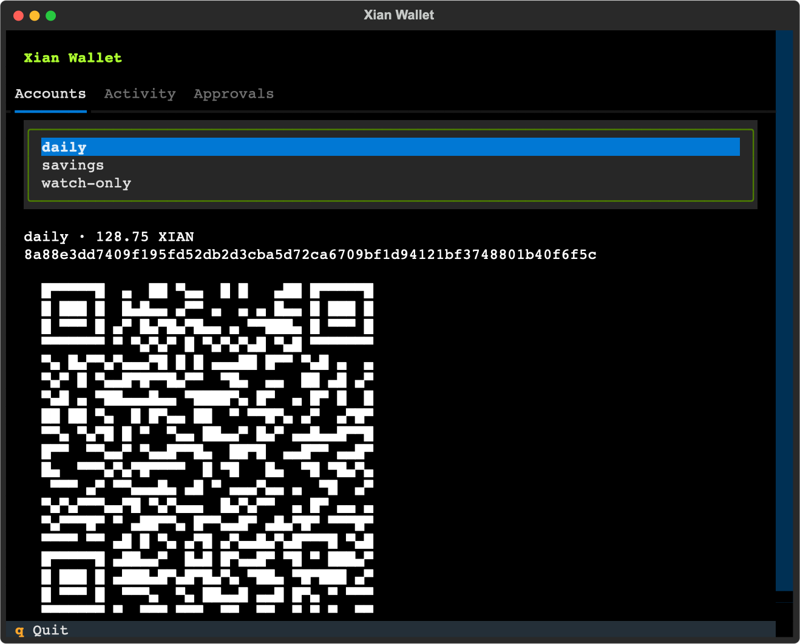
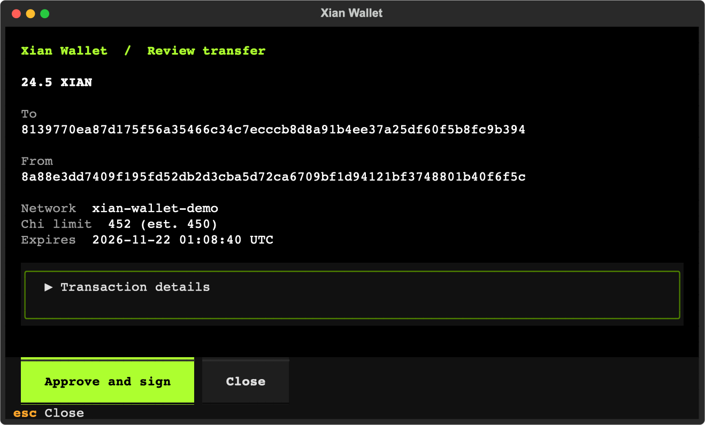

# Xian Wallet CLI

`xian-wallet` is a terminal wallet for Xian. It combines named accounts,
encrypted recovery backups, portfolio and activity views, and transaction
approval for people and agents. The CLI, Textual interface, and signer service
use the same Xian SDK transaction format.

## Install

Use Python 3.14 and uv on macOS or Linux.

```sh
uv tool install xian-tech-wallet-cli
xian-wallet --help
```

For shielded notes, install with `uv tool install 'xian-tech-wallet-cli[shielded]'`.
If uv reports that its executable directory is outside `PATH`, run
`uv tool update-shell` and open a fresh terminal.

Control the state directory with `--home` or `XIAN_WALLET_HOME`. It defaults
to `$XDG_STATE_HOME/xian-wallet` or `~/.local/state/xian-wallet`.

## Accounts and networks

```sh
xian-wallet account create primary
xian-wallet account backup primary --out primary.backup.json
xian-wallet receive primary --qr
xian-wallet ui
```



Use `account restore NAME --mnemonic-file FILE --index INDEX` for the same
mnemonic-derived address as the browser and mobile wallets. Use
`account import-key NAME --key-file FILE` for a previously generated raw
Ed25519 key, `account derive SOURCE NAME --index INDEX` for another account
from the same recovery phrase, and `account watch NAME ADDRESS` for a public
address. `account restore-backup FILE` verifies an encrypted CLI backup before
restoring it. `account export-recovery NAME --out FILE` writes the mnemonic
to an owner-only file for offline storage.

The vault unlocks only for each sensitive operation and prompts for its
password locally. Trusted signer processes can use `--password-file` for
an explicitly provisioned owner-only file. Use a separate OS identity or
host for a signer that serves agents.

The default RPC is `http://127.0.0.1:26657`. For a saved network, obtain the
chain ID and first-block hash from a trusted source. Add it with
`network add NAME URL --chain-id ID --first-block-hash HASH`, then select it
with `network use NAME` or the global `--network NAME` option. Named profiles
allow explicit HTTPS RPCs. The node must be synced and serve block 1.

## Review and send

```sh
xian-wallet contact add recipient "$RECIPIENT_ADDRESS"
xian-wallet prepare --from primary --to recipient --amount 1.25 --out proposal.json
xian-wallet approve proposal.json --account primary --out approval.json --textual
xian-wallet submit proposal.json --approval approval.json
```



Use `--token CONTRACT` for a fungible token. `token watch NAME CONTRACT`
adds a token to `portfolio ACCOUNT`. `activity` reads the local approval and
receipt journal. `incoming ACCOUNT --token CONTRACT` scans a page of
BDS-indexed transfers. Use the returned `next_offset` to keep scanning if a
page lacks matches.

Use `call CONTRACT FUNCTION --args ARGS.json` for read-only simulation.
Use `prepare-call` to prepare a typed write. Generic fractional values use
`{"__fixed__":"1.25"}`. The simulator and signing flow share the exact
payload. `dex`, `nft`, `message`, `x402`, `shielded`, and `walletconnect`
provide the product-specific workflows in the [wallet guide](https://github.com/xian-technology/xian-wallet-cli/blob/main/docs/WALLET.md).

## Agent approvals

The agent prepares a proposal and submits it to the trusted signer with
`agent request`. The owner reviews it using the Textual inbox or a configured
Telegram bot. The agent then uses `agent fetch` to obtain the signed approval
and submits it with `submit`. Use `grant` to opt into autonomous, revocable
transfers within an account, network, asset, recipient, amount, chi budget,
and expiry. The agent needs the signer socket or an SSH socket forward and
the relevant bearer credential. [Signer setup and examples](https://github.com/xian-technology/xian-wallet-cli/blob/main/docs/WALLET.md#agent-approvals)

Put `--json` before the command for one `xian-wallet-cli/v1` result on stdout.
Amounts are decimal strings. Normal usage errors go to stderr.

| Exit | Meaning |
| --- | --- |
| 0 | Command succeeded, or transfer committed successfully |
| 1 | Admission rejection, failed execution, or failed verification |
| 2 | Command, input, approval, file, or RPC error |
| 3 | Final outcome is pending or unknown |

After interruption, use `receipt TX_HASH` or retry the same proposal and
approval. The wallet only signs competing same-nonce proposals through an
explicit owner replacement. Keep the original hash available until one of
the competing transactions is finalized.

## Validation

From a source checkout, use `uv run xian-wallet --help` to run the CLI.

```sh
uv run --extra shielded ruff check
uv run --extra shielded ruff format --check
uv run --extra shielded pytest
node --test tests/walletconnect.test.mjs
```

## Related Docs

- [Wallet guide](https://github.com/xian-technology/xian-wallet-cli/blob/main/docs/WALLET.md)
- [Architecture](https://github.com/xian-technology/xian-wallet-cli/blob/main/docs/ARCHITECTURE.md)
- [Backlog](https://github.com/xian-technology/xian-wallet-cli/blob/main/docs/BACKLOG.md)
- [Xian Python SDK](https://github.com/xian-technology/xian-py)
- [Agent wallet skill](https://github.com/xian-technology/xian-ai-skills/blob/main/xian-wallet-cli-skill/SKILL.md)
